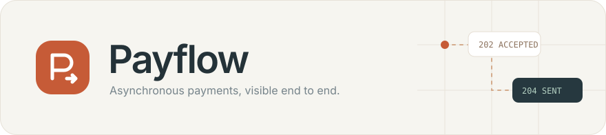
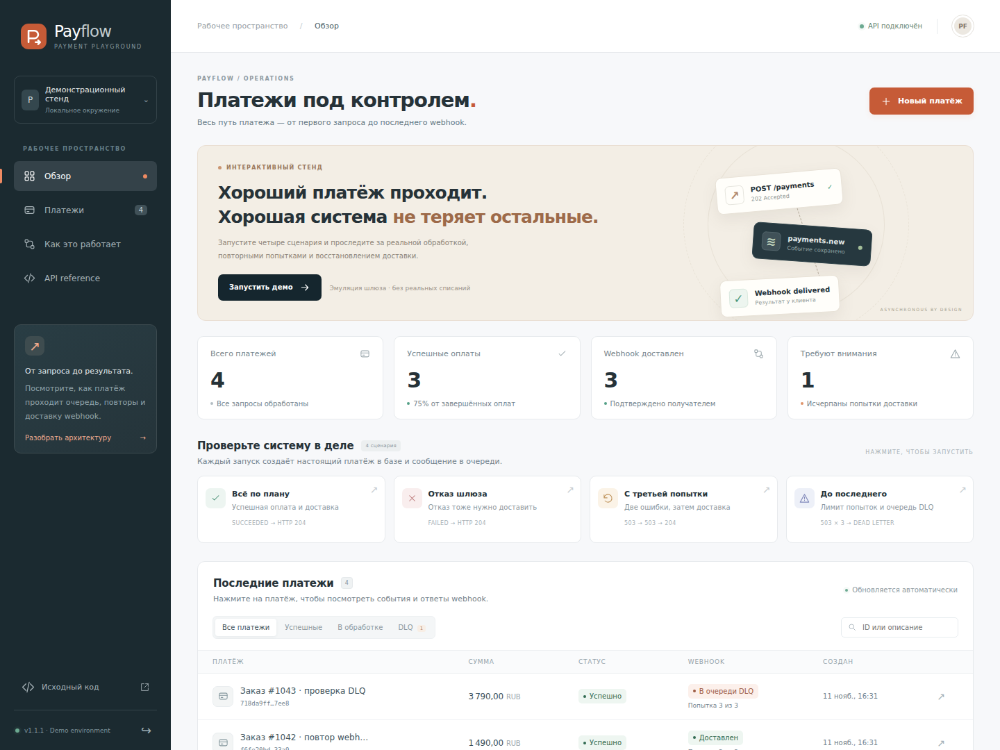
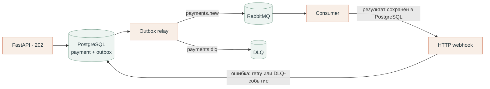

<p align="center">
  
</p>

<p align="center">
  <strong>Весь путь платежа — от запроса до доставленного webhook.</strong><br />
  Интерактивный стенд асинхронной обработки платежей на FastAPI, PostgreSQL и RabbitMQ.
</p>

<p align="center">
  <a href="https://github.com/jaFuart/payflow/actions/workflows/ci.yml"></a>
  <a href="https://github.com/jaFuart/payflow/releases"></a>
  <a href="pyproject.toml"></a>
</p>

<p align="center">
  <a href="#быстрый-старт">Быстрый старт</a> ·
  <a href="#четыре-сценария">Сценарии</a> ·
  <a href="#как-устроено">Архитектура</a> ·
  <a href="docs/api.md">API и эксплуатация</a> ·
  <a href="https://github.com/jaFuart/payflow/releases/tag/v1.1.1">Релиз 1.1.1</a>
</p>



<p align="center">
  <a href="docs/demo-payment.png">История платежа и HTTP-попытки</a> ·
  <a href="docs/demo-mobile.png">Мобильная версия</a>
</p>

Payflow делает обработку событий наблюдаемой: в панели видны результат шлюза, история outbox, повторные попытки webhook и восстановление доставки из DLQ. Счётчики, платежи и история загружаются из PostgreSQL; обработку выполняет отдельный consumer через RabbitMQ.

**Стек:** FastAPI · Pydantic v2 · SQLAlchemy asyncio · PostgreSQL 16 · RabbitMQ 4 · FastStream · Alembic · Docker Compose.

## Быстрый старт

Нужны Docker Engine или Docker Desktop и Docker Compose v2.

```bash
git clone https://github.com/jaFuart/payflow.git
cd payflow
cp .env.example .env
docker compose up --build -d --wait --wait-timeout 180
```

Откройте **[localhost:8000](http://localhost:8000)** и введите `API_KEY` из `.env`. Ключ в примере — `payflow-local-demo-key`. Панель запоминает его в текущей вкладке; выход удаляет ключ. Демосценарии включены в `.env.example` через `DEMO_ENABLED=true`.

API выполняет миграции перед запуском. PostgreSQL и RabbitMQ сохраняют данные в именованных volumes. RabbitMQ Management доступен на [localhost:15672](http://localhost:15672); учётные данные задаются в `.env`. Опубликованные порты привязаны к `127.0.0.1`.

## Четыре сценария

Запустите сценарий в панели и откройте карточку платежа: вкладки **История**, **Webhook** и **JSON** показывают последовательность событий и ответы получателя.

| Сценарий | Платёж | Webhook | Что можно проследить |
| --- | --- | --- | --- |
| **Всё по плану** · `success` | `succeeded` | `204` | Запрос → outbox → очередь → получатель. |
| **Отказ шлюза** · `decline` | `failed` | `204` | Отказ оплаты тоже доставляется клиенту. |
| **С третьей попытки** · `retry` | `succeeded` | `503 → 503 → 204` | Отложенные повторы с сохранённым результатом шлюза. |
| **До последнего** · `dlq` | `succeeded` | `503 × 3 → DLQ` | Исчерпание попыток и отдельный статус доставки. |

В карточке нажмите **Повторить запрос**: сохранятся UUID и исходный ключ идемпотентности. Для платежа в DLQ нажмите **Возобновить доставку**: новая серия завершится HTTP `204`, история сохранит обе серии, а результат и время обработки шлюза останутся прежними.

## Как устроено



API и consumer используют один Docker-образ с разными командами запуска. Платёж и первоначальное событие фиксируются одной транзакцией; consumer запускает outbox relay и обрабатывает сообщения с ручным подтверждением.

## Надёжность и границы гарантий

| Механизм | Поведение |
| --- | --- |
| **Transactional outbox** | Принятый платёж и событие сохраняются вместе. Недоступность брокера откладывает публикацию. |
| **Идемпотентность** | Уникальный ключ в PostgreSQL и отпечаток нормализованного запроса; повтор возвращает исходный платёж, другое тело — `409`. |
| **Подтверждённая публикация** | Persistent сообщения, publisher confirms, обязательная маршрутизация и quorum queues. |
| **Сохранённый результат шлюза** | Фиксируется до HTTP webhook и используется при повторах доставки. |
| **Отложенные повторы** | До трёх попыток на серию, задержки 1 и 2 секунды; расписание хранится в outbox. |
| **Поколения доставки** | Ручное восстановление увеличивает `delivery_generation`; устаревшие сообщения игнорируются. |
| **История в базе** | События и HTTP-запросы встроенного приёмника сохраняются и доступны после перезапуска. |

Доставка — **at least once**: после сбоя публикация или webhook могут повториться. Получатель дедуплицирует события по `payment_id` / `Idempotency-Key`. Compose использует один узел RabbitMQ; высокая доступность потребует кластера.

Шлюз — эмулятор без реальных списаний: задержка 2–5 секунд, вероятность успеха обычного платежа 90%. Четыре демосценария имеют заданный результат. При подключении настоящего шлюза нужен его собственный ключ идемпотентности для сбоя между списанием и фиксацией результата в базе.

## API

Все API-запросы требуют `X-API-Key`; создание платежа — также `Idempotency-Key`. Приёмник демосценариев использует отдельный HMAC-токен.

| Метод | Endpoint | Назначение |
| --- | --- | --- |
| `POST` | `/api/v1/payments` | Принять платёж, ответ `202`. |
| `GET` | `/api/v1/payments` | Список, фильтры, поиск и пагинация. |
| `GET` | `/api/v1/payments/{id}` | Результат шлюза и состояние доставки. |
| `GET` | `/api/v1/payments/{id}/events` | История обработки. |
| `GET` | `/api/v1/payments/{id}/webhooks` | HTTP-попытки встроенного приёмника. |
| `POST` | `/api/v1/payments/{id}/redeliver` | Новая серия доставки после исчерпания попыток. |
| `GET` | `/api/v1/stats` | Счётчики платежей, доставки и outbox. |
| `POST` | `/api/v1/demo/payments` | Запустить выбранный демосценарий. |

Примеры запросов, правила валидации, формат webhook, авторизация Swagger и проверки перезапуска — в **[API и эксплуатация](docs/api.md)**.

## Проверка

**99 модульных и API-тестов**, интеграционные проверки на PostgreSQL 16 / RabbitMQ 4, все четыре демосценария и восстановление DLQ. Отдельно проверена сохранность платежей, идемпотентности и сообщения DLQ после перезапуска четырёх сервисов. CI выполняет проверки перед публикацией контейнера.

```bash
uv sync --frozen
uv run pytest
uv run ruff check .
docker compose exec -T api python scripts/smoke.py
docker compose exec -T api python scripts/demo_smoke.py
```

Для локальных тестов нужны Python 3.12 и `uv`; интеграционные скрипты выполняются в запущенном Compose. [Перезапуск и простой consumer →](docs/api.md#проверка-перезапуска-и-outbox)

## Готовый контейнер

В [релизе 1.1.1](https://github.com/jaFuart/payflow/releases/tag/v1.1.1) доступны **[Payflow.zip](https://github.com/jaFuart/payflow/releases/download/v1.1.1/Payflow.zip)** с исходниками, **[Payflow-container.tar.gz](https://github.com/jaFuart/payflow/releases/download/v1.1.1/Payflow-container.tar.gz)** с образом и **[Payflow.sha256](https://github.com/jaFuart/payflow/releases/download/v1.1.1/Payflow.sha256)** с контрольными суммами. Распакуйте исходники, поместите контейнерный архив рядом с `compose.yaml` и выполните:

```bash
docker load -i Payflow-container.tar.gz
cp .env.example .env
docker compose up -d --no-build --wait --wait-timeout 180
```

GHCR-образ `ghcr.io/jafuart/payflow:1.1.1` требует авторизации с `read:packages`; контейнерный архив в публичном релизе доступен без неё. [Запуск через GHCR →](docs/api.md#готовый-образ-и-ghcr)

## Структура проекта

```text
app/          API, consumer, outbox relay, демосценарии и панель
migrations/   Миграции Alembic
tests/        Валидация, идемпотентность, обработка, восстановление
scripts/      Интеграционные проверки на запущенных сервисах
docs/         API, эксплуатация и скриншоты
compose.yaml  PostgreSQL, RabbitMQ, API и consumer
```
